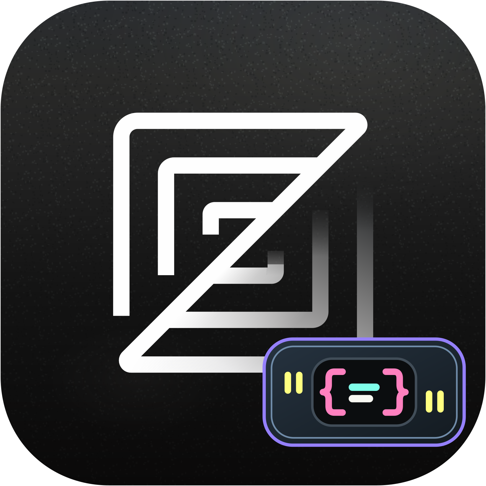

<div align="center">

# Embedded Languages LSP for Zed



**Get automatic syntax highlighting for code inside strings in Zed**. Write a SQL query in a Python function, a JSON payload in a JavaScript template or HTML in a Go raw string. The extension detects the embedded language and colors the string contents using semantic tokens from the languages extensions you already have installed.

</div>

```python
def report_query(active):
    if active:
        query = """
            SELECT u.id, COUNT(o.id) AS order_count
            FROM users AS u
            LEFT JOIN orders AS o ON o.user_id = u.id
            WHERE u.active = true
            GROUP BY u.id
        """
        return query
    return "SELECT id FROM users"
```

The file's language is the **host** (Python in this example). The code inside the string is the **target** (SQL). The extension works alongside the host's existing language servers, so the usual editor features and host syntax colors remain available.
- **Automatic detection** covers common SQL, structured JSON, HTML, XML and distinctive SCSS, TOML, nginx, Dockerfile and PowerShell syntax. A compatible installed grammar can also be selected by its first-line signature or by unambiguous syntax evidence.
- **Strings assembled from several pieces** can be highlighted as one snippet. This includes literal concatenation and consecutive supported assignments such as Python `+=` chains. Each piece receives its own highlights at the correct location.
- **Interpolation and escapes** follow the host's syntax. The extension can analyze Python f-strings, `%` formatting and `.format()`, JavaScript and TypeScript templates, C# interpolation, Go `fmt.Sprintf` and Rust `format!`. Host expressions keep their host colors.
- **Language hints** let you choose a target for a short or ambiguous snippet. For recurring patterns, you can add an automatic detector in Zed settings.

## Quick start

1. **Install the extension** using the [source](#install-from-source) or [Windows prebuilt](#install-a-prebuilt-release-on-windows) instructions below.
2. **Install the target language extension in Zed**. Start with **SQL** for the example above. JSON highlighting is bundled. For the other examples, install the corresponding target extensions (for example HTML, XML, SCSS & SASS, TOML, nginx, Dockerfile or PowerShell).
3. **Enable combined semantic token**. Open `zed: open settings file` and merge the following for the host language you want to try first :  
   ```json
   {
     "languages": {
       "Python": {
         "semantic_tokens": "combined",
         "language_servers": ["...", "embedded-languages"]
       }
     }
   }
   ```
   If you already have an explicit `language_servers` list, append `"embedded-languages"` to that list and retain your existing entries and exclusions. Use the Zed language name shown for your file. To use the repository's JSON-specific theme styles, merge `global_lsp_settings.semantic_token_rules` from [zed-settings.json](zed-settings.json). That file also has examples for other hosts. [Zed language server settings](https://zed.dev/docs/configuring-languages#choosing-language-servers)
4. **Open a host file**. Open the checkout as a folder, review and trust it if Zed prompts, then open [the Python example](examples/example.py). The companion fetches its npm dependencies through Zed's Node runtime on first launch. The Languages Server menu in the status bar should list `embedded-languages` when it is running. [Zed worktree trust](https://zed.dev/docs/worktree-trust)

### Install from source

Install Rust via [rustup](https://rustup.rs/), then run `rustup target add wasm32-wasip2`. In Zed, run `zed: install dev extension` and select the checkout folder containing `extension.toml`. Zed builds the extension. [Zed extension development guide](https://zed.dev/docs/extensions/developing-extensions)

### Install a prebuilt release on Windows

Download the `zed-embedded-languages-<version>.zip` asset from [GitHub Releases](https://github.com/EDM115/zed-embedded-languages/releases). Extract the archive containing `extension.toml` and `extension.wasm`, then quit Zed.  
Run these PowerShell commands from the extracted directory :
```powershell
$target = Join-Path $env:LOCALAPPDATA 'Zed\extensions\installed\embedded-languages-lsp'
New-Item -ItemType Directory -Path $target -Force | Out-Null
Copy-Item -LiteralPath '.\extension.toml', '.\extension.wasm' -Destination $target
(Get-Item -LiteralPath (Split-Path -Parent $target)).LastWriteTimeUtc = [DateTime]::UtcNow
```
Reopen Zed and finish the [quick start](#quick-start). Use the same steps to replace an installed prebuilt version.

## Explore the examples

Open these files in Zed to compare automatic matches, hints and strings that stay plain. You can inspect the highlighting without running the snippets or starting any services. For each file, enable the companion for its host language and install the relevant target grammars.

| Host | File | Highlights to look for |
| --- | --- | --- |
| Python | [example.py](examples/example.py) | Branch-local SQL, nested MariaDB `TRIM`, recursive CTEs, SQLite binds, joined strings, formatting and all nine built-in target detectors |
| JavaScript | [example.js](examples/example.js) | Cooked and raw templates, escaped JSON and HTML attributes and appended SQL |
| TypeScript | [example.ts](examples/example.ts) | Typed SQL branches, template interpolation, a quoted XML declaration and structured JSON |
| JSX | [example.jsx](examples/example.jsx) | HTML and JSON inside strings next to native JSX |
| TSX | [example.tsx](examples/example.tsx) | Typed props, interpolated SQL and markup templates |
| Go | [example.go](examples/example.go) | Raw strings and a query built with `fmt.Sprintf` and `+=` |
| Rust | [example.rs](examples/example.rs) | Hash-delimited raw strings, `format!` and assembled SQL |
| C | [example.c](examples/example.c) | SQLite binds, recursive SQL, JSON arrays and HTML |
| C++ | [example.cpp](examples/example.cpp) | Named raw-string delimiters for SQL, JSON, SCSS and XML |
| C# | [example.cs](examples/example.cs) | Interpolated and verbatim strings |
| Java | [Example.java](examples/Example.java) | SQL, JSON and HTML in Java text blocks |
| PHP | [example.php](examples/example.php) | SQL joined with `.` and standalone embedded targets |
| Ruby | [example.rb](examples/example.rb) | SQL, JSON and markup inside quoted strings |
| Shell Script | [example.sh](examples/example.sh) | Quoted SQL, JSON and markup assignments |
| PowerShell | [example.ps1](examples/example.ps1) | SQL bind placeholders, nested JSON and XML |
| JSON | [example.json](examples/example.json) | SQL and HTML in JSON string values |
| CSS | [example.css](examples/example.css) | JSON and SQL inside custom-property values |
| SCSS | [example.scss](examples/example.scss) | SQL and JSON in Sass variables |
| Sass | [example.sass](examples/example.sass) | Embedded SQL and markup in indented Sass |
| TOML | [example.toml](examples/example.toml) | Multiline literal SQL and JSON, plus an nginx fragment |
| Dockerfile | [Dockerfile](examples/Dockerfile) | Embedded SQL and HTML in quoted `ENV` values |
| nginx | [nginx.conf](examples/nginx.conf) | Embedded SQL and HTML inside quoted directive arguments |

## Guide a detection

### Mark one string

Use `# sql` in Python, or put `language=<target>` in a host-appropriate comment on the preceding line. For example, `# language=sql` in Python or `// language=sql` in TypeScript. In Python, `# sql` can also precede a string argument :
```python
def preview():
    # sql
    projection = "SELECT display_name"
    return projection
```
This is useful for fragments such as a projection with no `FROM` clause. The target can be an installed language name, grammar name or recognized file suffix. The relevant parser and highlight query still need to be available.

### Add a reusable detector

Use `autoDetect` for strings with a recognizable opening that the built-in detectors do not cover. Rules use JavaScript regular expressions matched against the trimmed string body. Custom rules run before built-in rules, in the order you list them. Set `ignoreCase` to `true` when needed.  
This rule selects XML for configuration elements that omit an XML declaration (it requires the XML extension) :
```json
{
  "lsp": {
    "embedded-languages": {
      "initialization_options": {
        "autoDetect": [
          { "language": "xml", "pattern": "^<configuration\\b" }
        ]
      }
    }
  }
}
```
Focus the host file and run `editor: restart language server` after changing these options or installing a new target grammar.

### Add a host language

Host names in [extension.toml](extension.toml) come from the published Zed extension catalog. If the language is already registered, install its Zed language extension and restart the companion. For a new host name, regenerate the local manifest and restart Zed.  
From a source checkout, run `npm ci --prefix server --ignore-scripts`, then pass the installed-extensions directory to the updater. The command below uses the default Windows profile path :
```powershell
$installed = Join-Path $env:LOCALAPPDATA 'Zed\extensions\installed'
node server/update-manifest.mjs --installed $installed
```
For a prebuilt installation on Windows, start the companion once so Zed extracts the updater and its dependencies. Quit Zed before running these commands :
```powershell
$data = Join-Path $env:LOCALAPPDATA 'Zed\extensions'
$installed = Join-Path $data 'installed'
$updater = Join-Path $data 'work\embedded-languages-lsp\update-manifest.mjs'
$manifest = Join-Path $installed 'embedded-languages-lsp\extension.toml'
node $updater --installed $installed --manifest $manifest
```
If the host grammar uses unusual names for string nodes, set `lsp.embedded-languages.initialization_options.hosts.<languageId>.stringNodes` to the relevant Tree-sitter node names. Use the host's ID from the manifest's `language_ids` table. A custom list replaces the inferred node list for that host.

## Troubleshooting

| Symptom | Check |
| --- | --- |
| The Languages Server menu lacks `embedded-languages` | Check the active file's Zed language, worktree trust and effective `language_servers` list. Focus the editor and run `editor: restart language server`. |
| The server is running but all strings have their usual color | Check that `semantic_tokens` is `"combined"` for the host and that the target's Zed grammar is installed. Try the Python example with SQL installed or test bundled JSON. |
| One snippet stays plain | Try a language hint. Automatic detection prefers a clear match and dialect syntax or incomplete snippets can be ambiguous for the installed parser. |
| The companion disappears after replacing the WASM on Windows | Install the new WASM while Zed is closed. If the extension has already reloaded, restart the language server from a focused host buffer and check the Languages Server menu. |
| The server fails to start | Run `zed: open log` and look for `embedded-languages` or a Node/npm setup error. The first start needs access to the npm registry if the dependencies are missing. |

## How highlighting works

Tree-sitter locates literal ranges in the host file. The companion assembles supported literal pieces, masks interpolation and parses likely targets with their highlight queries. For known grammar gaps it can validate a parser-compatible copy. It sends the resulting highlights as LSP semantic tokens in the original file's UTF-16 coordinates. Your Zed theme supplies the colors.  
The companion supplies highlighting only. It uses compatible installed Tree-sitter parsers and queries for targets, with bundled JSON highlighting and parser fallbacks for several common hosts. Consecutive assignment analysis is local and syntactic, so calls, intervening statements, reassignments and branch boundaries end a chain.

## Development

Run the tests and build the WASM from the repository root. The example below points tests at an existing Zed profile on Windows. On another platform, set `ZED_TEST_EXTENSIONS_DIR` to the corresponding installed-extensions directory :
```powershell
npm ci --prefix server --ignore-scripts
$env:ZED_TEST_EXTENSIONS_DIR = Join-Path $env:LOCALAPPDATA 'Zed\extensions\installed'
node --test tests/*.test.mjs
cargo build --locked --release --target wasm32-wasip2
```
Tests that need a specific installed grammar skip if that grammar is missing. For a prebuilt archive, copy `target/wasm32-wasip2/release/embedded_languages_lsp.wasm` to `extension.wasm` and package it alongside `extension.toml`.  
To refresh the published host catalog, run `pwsh -File scripts/update-language-registry.ps1`. It reads the [official registry](https://github.com/zed-industries/extensions/blob/main/extensions.toml) and the marketplace archives, then saves the audit to `.tmp/zed-language-registry/audit.json`.  
[Changelog](CHANGELOG.md) · [MIT license](LICENSE)
